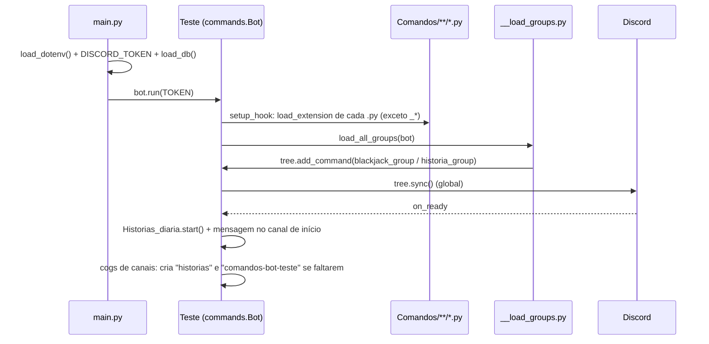
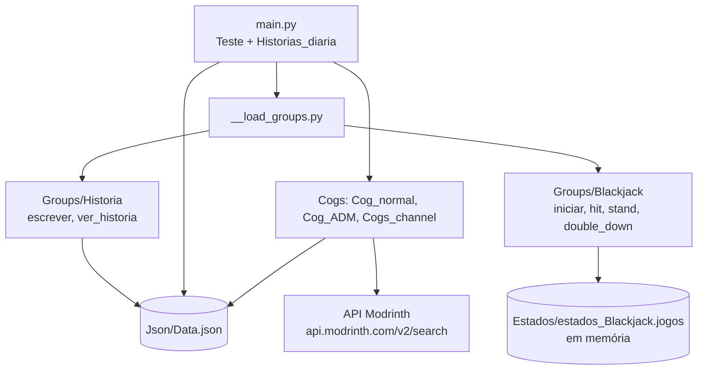

# Arquitetura

## Inicialização



## Componentes



## Tarefa diária

```mermaid
flowchart LR
    T[tasks.loop 1 min] --> H{12:00 em America/Sao_Paulo?}
    H -->|não| T
    H -->|sim| L[load_db]
    L --> V{historia vazia?}
    V -->|sim| S1[envia 'Sem histórias pra zerar']
    V -->|não| S2[envia história + @everyone] --> Z[historia = [] + save_db]
```

## Tratamento de erros

- Falhas ao carregar um cog ou group são **impressas no console** e o bot segue com os demais.
- A tarefa diária captura exceções e só imprime a mensagem.
- Comandos não tratam erros do Discord (permissão de *timeout*, canal inexistente) nem da API do Modrinth: a exceção sobe para o handler padrão do discord.py, e o usuário vê "O aplicativo não respondeu".
- Logs vão para o `stdout` com `print` (no Docker, `docker logs`).
